## Customer Churn Rate Analysis in a Telecom Company

Customer churn is a critical concern for telecom companies, as retaining existing customers is often more cost-effective than acquiring new ones. This project aims to analyze customer churn in a telecom company, leveraging customer demographics, account details, and service subscriptions to identify key factors influencing churn. By exploring patterns in the data, we seek to uncover insights that can help predict and reduce customer attrition, ultimately improving customer retention strategies. Fasten up the seat belt, and let's explore this ocean!

#### Loading libraries


#### Load data


::: {.cell}

```{.r .cell-code}
telco_data <- read.csv("https://raw.githubusercontent.com/dsrscientist/DSData/master/Telecom_customer_churn.csv")

# View the first few rows
head(telco_data)
```

::: {.cell-output .cell-output-stdout}

```
  customerID gender SeniorCitizen Partner Dependents tenure PhoneService
1 7590-VHVEG Female             0     Yes         No      1           No
2 5575-GNVDE   Male             0      No         No     34          Yes
3 3668-QPYBK   Male             0      No         No      2          Yes
4 7795-CFOCW   Male             0      No         No     45           No
5 9237-HQITU Female             0      No         No      2          Yes
6 9305-CDSKC Female             0      No         No      8          Yes
     MultipleLines InternetService OnlineSecurity OnlineBackup DeviceProtection
1 No phone service             DSL             No          Yes               No
2               No             DSL            Yes           No              Yes
3               No             DSL            Yes          Yes               No
4 No phone service             DSL            Yes           No              Yes
5               No     Fiber optic             No           No               No
6              Yes     Fiber optic             No           No              Yes
  TechSupport StreamingTV StreamingMovies       Contract PaperlessBilling
1          No          No              No Month-to-month              Yes
2          No          No              No       One year               No
3          No          No              No Month-to-month              Yes
4         Yes          No              No       One year               No
5          No          No              No Month-to-month              Yes
6          No         Yes             Yes Month-to-month              Yes
              PaymentMethod MonthlyCharges TotalCharges Churn
1          Electronic check          29.85        29.85    No
2              Mailed check          56.95      1889.50    No
3              Mailed check          53.85       108.15   Yes
4 Bank transfer (automatic)          42.30      1840.75    No
5          Electronic check          70.70       151.65   Yes
6          Electronic check          99.65       820.50   Yes
```


:::
:::


# Data Processing

#### Data inspection


::: {.cell}

:::


#### Checking Data Quality


::: {.cell}
::: {.cell-output-display}
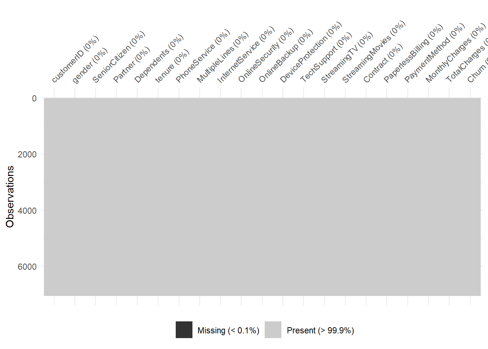{width=672}
:::
:::


What we want to know what percentage of our data is missing? We can use `vis_miss` to provide the amount of missings in each columns.

We see that only less than 0.01% of our data is missing.

Missing values are common in datasets and should be thoroughly examined and addressed early in the analysis process. This is where we can use the `naniar` and `visdat` packages come in when creating the visualization.

For more readings on how to visualize missing data, find it [here](https://cran.r-project.org/web/packages/naniar/vignettes/getting-started-w-naniar.html)


::: {.cell}

```{.r .cell-code}
gg_miss_var(telco_data) + 
  labs(title = "Missing Values in Each Column", y = "Look at all the missing ones") +
  theme_bw()
```

::: {.cell-output-display}
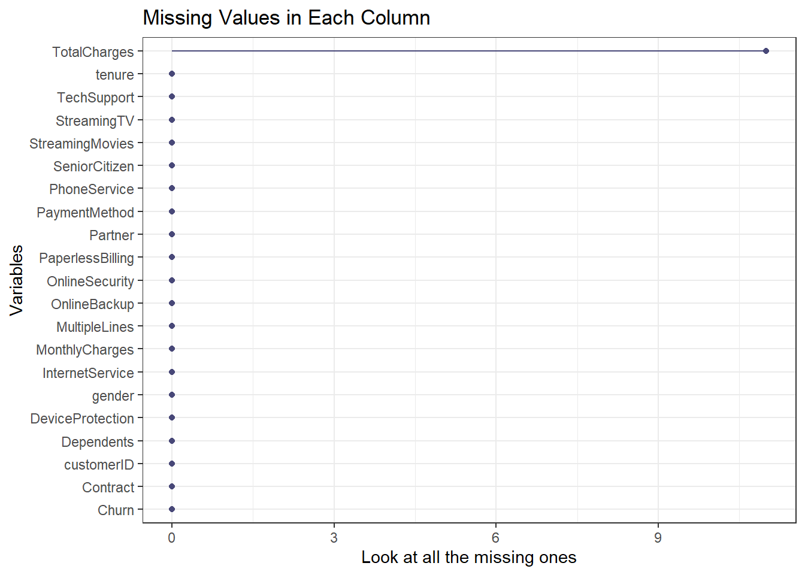{width=672}
:::
:::


From the chart, we are able to confirm that only `TotalChrges` column is the only column with the missing values with more than 9 values.

#### Data Cleaning


::: {.cell}

```{.r .cell-code}
# Wrangle the data
telco_data <- telco_data |>
#    mutate(Churn = ifelse(Churn == "Yes", 1, 0)) |>
    mutate(Churn = as.factor(Churn), # Convert 'Churn' to a factor variable
           tenure = as.numeric(tenure),
           MonthlyCharges = as.numeric(MonthlyCharges),
           TotalCharges = as.numeric(TotalCharges)) |>
    replace_na(list(tenure = 0, MonthlyCharges = 0, TotalCharges = 0)) |>
    distinct() |>
    filter(!is.na(Churn)) |> # Explicitly handle NA values in 'Churn'
    select(-customerID)

# Check the summary of the dataset
summary(telco_data)
```

::: {.cell-output .cell-output-stdout}

```
    gender          SeniorCitizen      Partner           Dependents       
 Length:7043        Min.   :0.0000   Length:7043        Length:7043       
 Class :character   1st Qu.:0.0000   Class :character   Class :character  
 Mode  :character   Median :0.0000   Mode  :character   Mode  :character  
                    Mean   :0.1621                                        
                    3rd Qu.:0.0000                                        
                    Max.   :1.0000                                        
     tenure      PhoneService       MultipleLines      InternetService   
 Min.   : 0.00   Length:7043        Length:7043        Length:7043       
 1st Qu.: 9.00   Class :character   Class :character   Class :character  
 Median :29.00   Mode  :character   Mode  :character   Mode  :character  
 Mean   :32.37                                                           
 3rd Qu.:55.00                                                           
 Max.   :72.00                                                           
 OnlineSecurity     OnlineBackup       DeviceProtection   TechSupport       
 Length:7043        Length:7043        Length:7043        Length:7043       
 Class :character   Class :character   Class :character   Class :character  
 Mode  :character   Mode  :character   Mode  :character   Mode  :character  
                                                                            
                                                                            
                                                                            
 StreamingTV        StreamingMovies      Contract         PaperlessBilling  
 Length:7043        Length:7043        Length:7043        Length:7043       
 Class :character   Class :character   Class :character   Class :character  
 Mode  :character   Mode  :character   Mode  :character   Mode  :character  
                                                                            
                                                                            
                                                                            
 PaymentMethod      MonthlyCharges    TotalCharges    Churn     
 Length:7043        Min.   : 18.25   Min.   :   0.0   No :5174  
 Class :character   1st Qu.: 35.50   1st Qu.: 398.6   Yes:1869  
 Mode  :character   Median : 70.35   Median :1394.5             
                    Mean   : 64.76   Mean   :2279.7             
                    3rd Qu.: 89.85   3rd Qu.:3786.6             
                    Max.   :118.75   Max.   :8684.8             
```


:::
:::


From the summary, we can gain great insights about the data we are dealing, for example, we now have the total summary of churned customer compared to active customers to be 1869 and 5174 respectively. We have the quartiles information on the total charges information that can helps us understand the business revenue performance.

## Plotting

#### Distribution of variables


::: {.cell}

```{.r .cell-code}
# Check the distribution of 'Churn'

# Summarized data frame with counts and percentages
churn_summary <- telco_data |>
  group_by(Churn) |>
  summarise(count = n()) |>
  mutate(percent = round(100 * count / sum(count), 1))

# Plot
ggplot(churn_summary, aes(x = Churn, y = count, fill = Churn)) +
  geom_bar(stat = "identity", color = "black") +
  geom_text(aes(label = paste0(percent, "%")),
            vjust = 1.5, color = "white", size = 5) +
  labs(title = "Distribution of Churn", 
       x = "Churn", 
       y = "Count") +
  theme_minimal() +
  theme_gray()
```

::: {.cell-output-display}
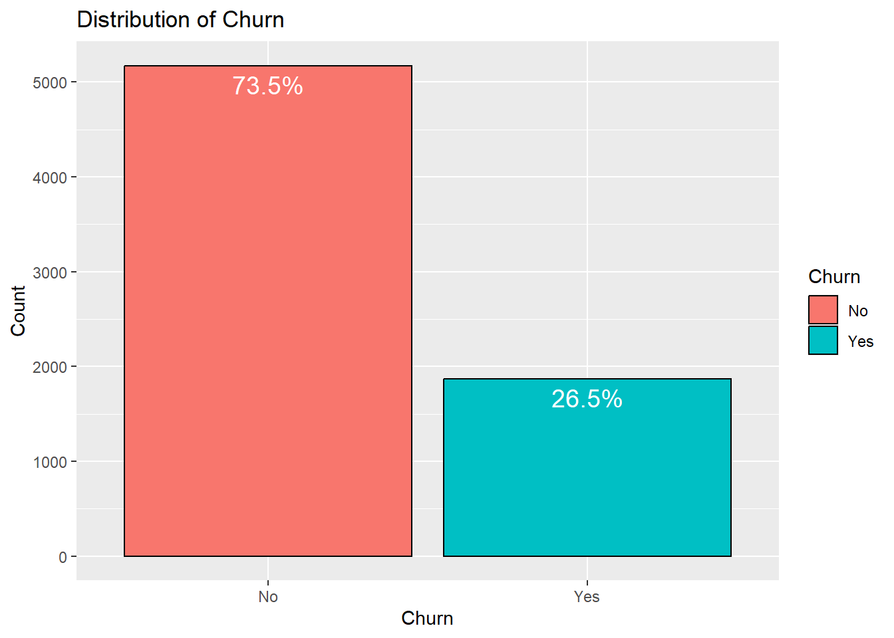{width=672}
:::
:::


The above chart help us understand how distribution is between active customers in the business versus those who churned. We have 73.5% customers reported as active and 26.5% aready churned. At this point, it would be great for the management to investigate why the customers are churning of over a quarter of the customer base.

Aside from that, we can also investigate how the charges are distributed.


::: {.cell}

```{.r .cell-code}
# Check the distribution of 'TotalCharges'
ggplot(telco_data, aes(x = TotalCharges)) +
  geom_histogram(bins = 30, fill = "blue", color = "black") +
  labs(title = "Distribution of Total Charges",
       caption = "Distubutuion charges in a telecommunicaton",
       x = "Total Charges", 
       y = "Count") +
  theme_minimal()
```

::: {.cell-output-display}
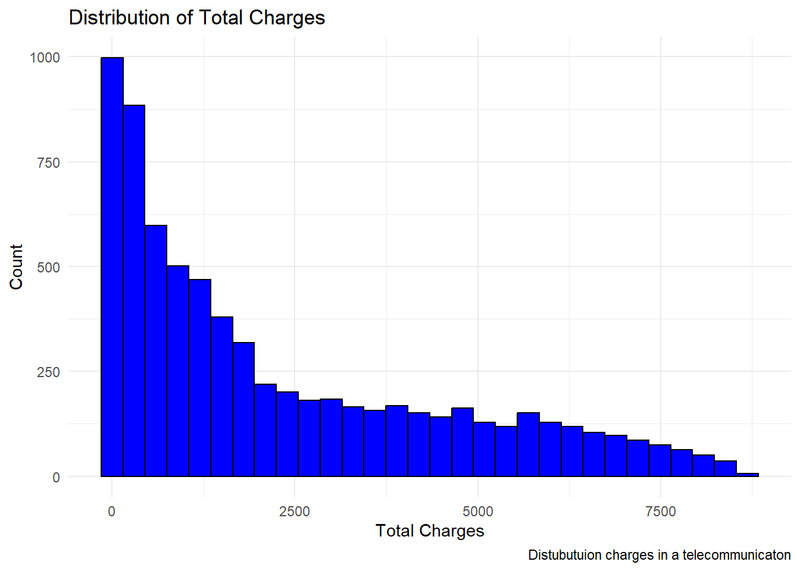{width=672}
:::
:::


The bove chart shows that the distribution is right skewed meaning most customers have lower total charges, while a smaller number have very high charges, stretching the tail to the right.

On factor to help determine patterns that influence whether a customer is likely to stay or leave is their tenure in the business. Why this is important

-   **Short Tenure**: Customers who have been with the company for a short time might have a higher churn rate, as they might still be exploring options or not fully integrated into the service.

<!-- -->

-    **Long Tenure**: Customers who have been with the company for a long time may have a **lower churn rate** due to loyalty or a reluctance to change, especially if they’ve developed habits around the service.


::: {.cell}

```{.r .cell-code}
# Check the distribution of 'tenure'
ggplot(telco_data, aes(x = tenure)) +
  geom_histogram(bins = 30, fill = "green", color = "black", alpha = 0.5) +
  geom_density(aes(y = ..count..), fill = "blue", alpha = 0.2) +  # Add density curve
  labs(title = "Distribution of Tenure with Density", x = "Tenure (Months)", y = "Count") +
  theme_minimal()
```

::: {.cell-output-display}
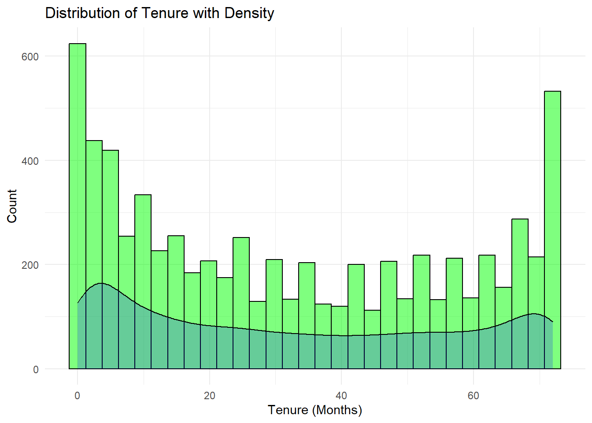{width=672}
:::
:::


Some of the reasons why we need these analysis include creating features such as:

-   [**Customer Lifetime Value (CLV)**](https://www.qualtrics.com/en-au/experience-management/customer/customer-lifetime-value/#:~:text=with%20our%20guide.-,What%20is%20customer%20lifetime%20value%20(CLV)?,useful%20for%20tracking%20business%20success.): Calculate the expected revenue based on tenure. This is a metric that predicts the total net profit a business can expect to earn from a customer throughout their entire relationship, helping businesses understand customer value for informed decisions on acquisition, retention, and marketing strategies

<!-- -->

-    **Churn Risk by Tenure**: Categorize customers into groups like "new," "mid-term," and "long-term" to examine how churn rates differ across these groups.


::: {.cell}

```{.r .cell-code}
# Create tenure categories
telco_data$TenureGroup <- cut(telco_data$tenure,
                               breaks = c(0, 6, 12, 36, 100),
                               labels = c("0-6 months", "6-12 months", "1-3 years", "3+ years"))

# Tenure distribution with categories
ggplot(telco_data, aes(x = TenureGroup, fill = TenureGroup)) +
  geom_bar(color = "black") +
  labs(title = "Customer Distribution by Tenure Group", x = "Tenure Group", y = "Count") +
  theme_minimal() +
  theme(legend.position = "none")
```

::: {.cell-output-display}
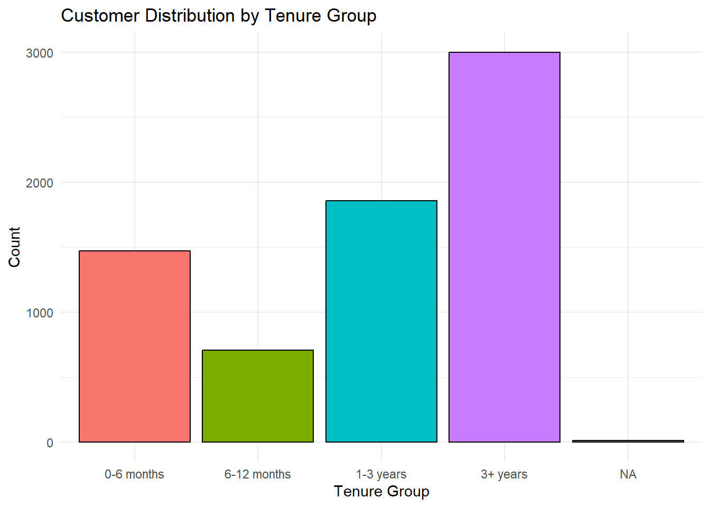{width=672}
:::
:::


From the above analysis of the dicrutbution of tenure, we can conclude that customer who have been with the business for more than 3+ years are likely to stay with the business

To go deeper, let's examine the proportion of customer churn to tenure. This gives us a finer insights on what should be our focus. We will create a tenure group to find at what stage are we losing more customers.


::: {.cell}

```{.r .cell-code}
# Churn Rate by Tenure Group
churn_tenure_summary <- telco_data |>
  group_by(TenureGroup, Churn) |>
  summarise(count = n(), .groups = 'drop') |>
  group_by(TenureGroup) |>
  mutate(percent = round(100 * count / sum(count), 1)) |>
  filter(!is.na(TenureGroup))

# Plot with percentages
ggplot(churn_tenure_summary, aes(x = TenureGroup, y = count, fill = Churn)) +
  geom_bar(stat = "identity", color = "black") +
  geom_text(aes(label = paste0(percent, "%")), 
            position = position_stack(vjust = 0.5), size = 5, color = "white") +  
  labs(title = "Churn Rate by Tenure Group", 
       x = "Tenure Group", 
       y = "Proportion of Churn") +
  theme_minimal() +
  theme(legend.position = "top")
```

::: {.cell-output-display}
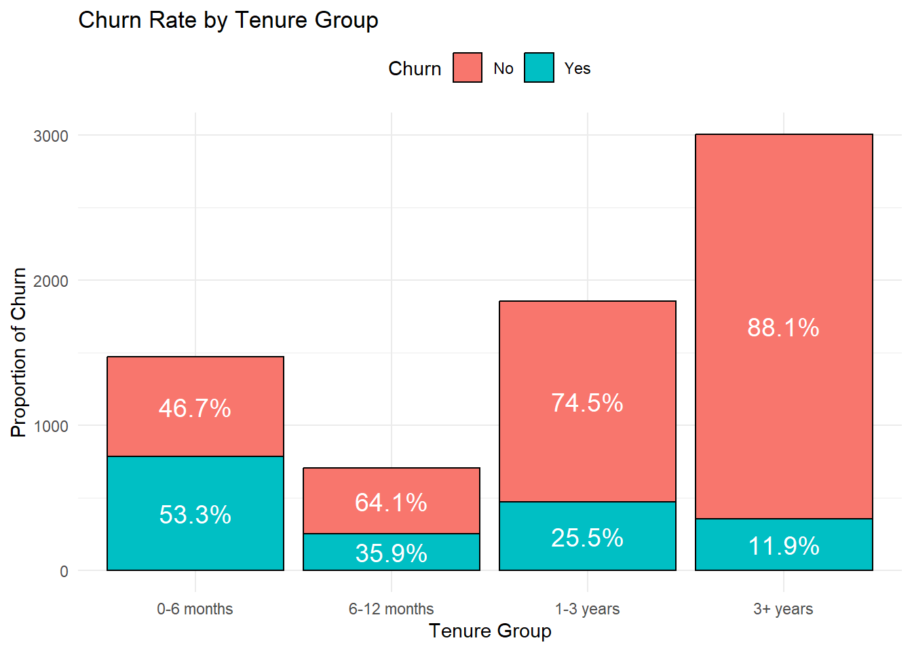{width=672}
:::
:::


From the graph, the business needs to focus more on the on boarding period of 0-12 months since it is at these periods that we have a higher churn rate compared to tenure.

To switch gears, we now need understand the distribution of monthly charges. It can provide key insights into customer behavior, churn, and pricing strategies. From this, we can understand:


::: {.cell}

```{.r .cell-code}
# Check the distribution of 'MonthlyCharges'
ggplot(telco_data, aes(x = MonthlyCharges)) +
  geom_histogram(bins = 30, fill = "lightblue", color = "black", alpha = 0.5) +
  geom_density(aes(y = ..count..), fill = "blue", alpha = 0.2) +
  labs(title = "Distribution of Monthly Charges", 
       x = "Monthly Charges", 
       y = "Count",
       tag = "Figure 1",) +
  theme_minimal()
```

::: {.cell-output-display}
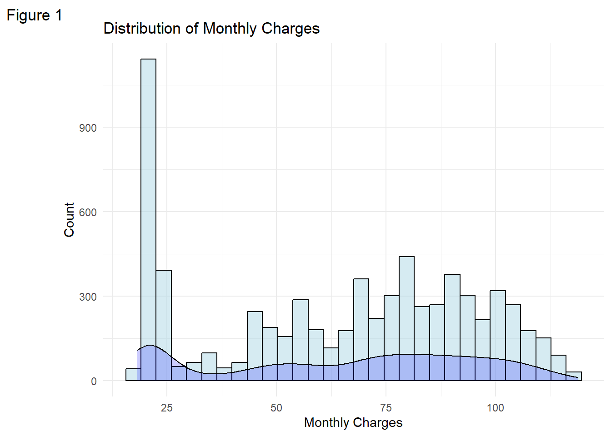{width=672}
:::

```{.r .cell-code}
ggplot(telco_data, aes(x = MonthlyCharges, fill = Churn)) +
  geom_histogram(bins = 30, alpha = 0.6, position = "identity", color = "black") +
  labs(title = "Monthly Charges by Churn", 
       x = "Monthly Charges", 
       y = "Count",
       tag = "Figure 2",) +
  theme_minimal()
```

::: {.cell-output-display}
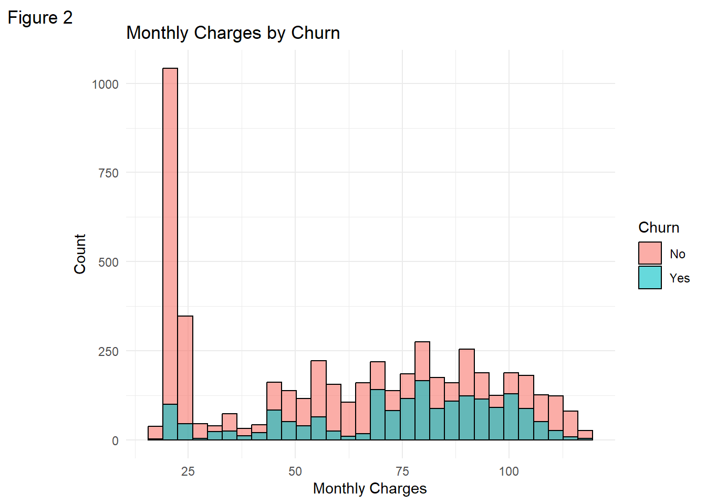{width=672}
:::
:::


This will help you see if there are higher churn rates at specific monthly charge levels.

#### `MonthlyCharges` Summary Statistics


::: {.cell}

```{.r .cell-code}
#Summary statistics
summary(telco_data$MonthlyCharges)
```

::: {.cell-output .cell-output-stdout}

```
   Min. 1st Qu.  Median    Mean 3rd Qu.    Max. 
  18.25   35.50   70.35   64.76   89.85  118.75 
```


:::
:::


Understanding the summary statistics of the monthly charges helps us understand the central tendencies and spread of the monthly charge. From the output, we can conclude that:

-   The **range** of monthly charges is from **18.25** (minimum) to **118.75** (maximum), so there's quite a bit of **variance** in pricing.

<!-- -->

-    The **first quartile (35.50)** and **third quartile (89.85)** show that the **middle 50% of customers** have charges between **35.50 and 89.85**.

<!-- -->

-    The **median (70.35)** being higher than the **mean (64.76)** suggests a **slight left skew** in the data. This means there are some customers paying much lower charges that are pulling the average down.

<!-- -->

-    The distribution appears to be **right-skewed,** as we can also see in `Figure 2` above, with a lot of customers paying lower charges and fewer customers paying very high charges.

A large portion of customers seem to paying **under 70** per month, with a few higher-paying customers. This could impact **churn behavior** and might suggest that low-cost customers are more price-sensitive, while higher-cost customers could be at risk if they perceive a lack of value.

#### The Correlation Analysis

The correlation analysis provides insights into the relationships between the numerical variables in the customer churn dataset. By calculating the correlation matrix and visualizing it using a correlation plot, we can quickly identify which variables are positively or negatively related to each other. For instance, we may observe a strong positive correlation between `MonthlyCharges` and `TotalCharges`, which makes sense since total charges are typically accumulated from monthly payments.


::: {.cell}

```{.r .cell-code}
# Check the correlation between numerical variables
correlation_matrix <- cor(telco_data |> select_if(is.numeric))
# Plot the correlation matrix. Here we use the corrplot package
corrplot(correlation_matrix, method = "circle", type = "upper", tl.col = "black", tl.srt = 45)
```

::: {.cell-output-display}
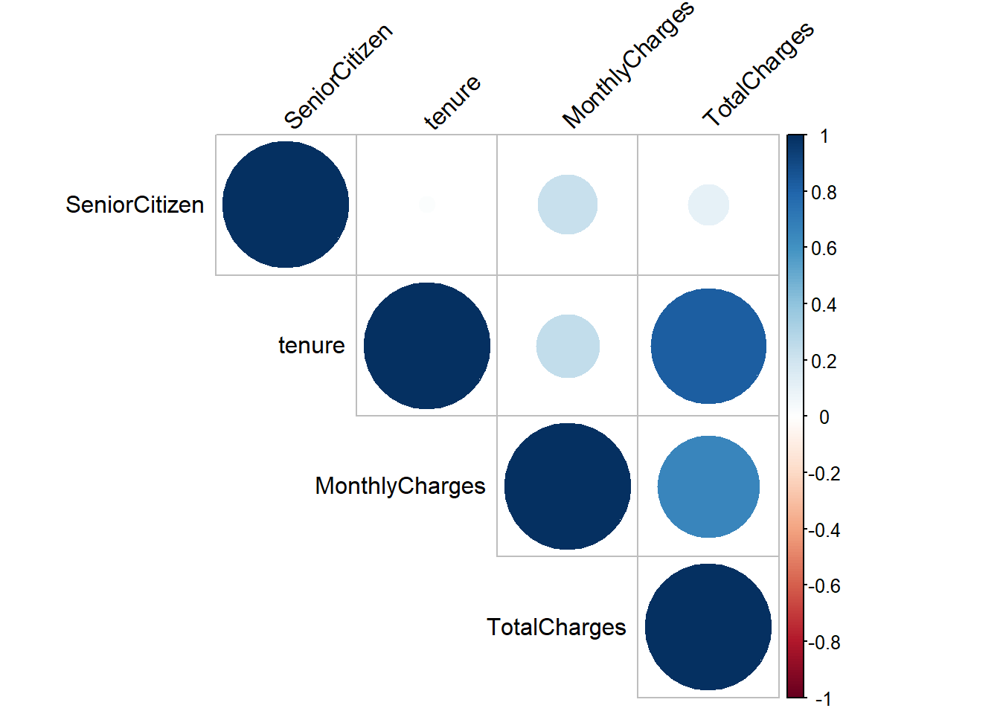{width=672}
:::
:::


We are able to notice that there is a strong relationship between `TotalCharges` and `tenure` which makes logic since total charges accumulate over time. There is a moderately positive relationship between `TotalCharges` and `MonthlyCharges` which also is true since customer who pay more will have higher total charges.

There is a weak correlation between `SeniorCitizen` and other variables (`tenure`, `MonthlyCharges`, `TotalCharges`). We can therefore conclude that being a senior citizen does not significantly correlate with tenure, monthly charges, or total charges hence not much of a factor in this case.


::: {.cell}

```{.r .cell-code}
# Check the relationship between 'Churn' and 'TotalCharges'
ggplot(telco_data, aes(x = TotalCharges, fill = Churn)) +
  geom_histogram(bins = 30, position = "identity", alpha = 0.5) +
  labs(title = "Total Charges vs Churn", x = "Total Charges", y = "Count") +
  theme_minimal()
```

::: {.cell-output-display}
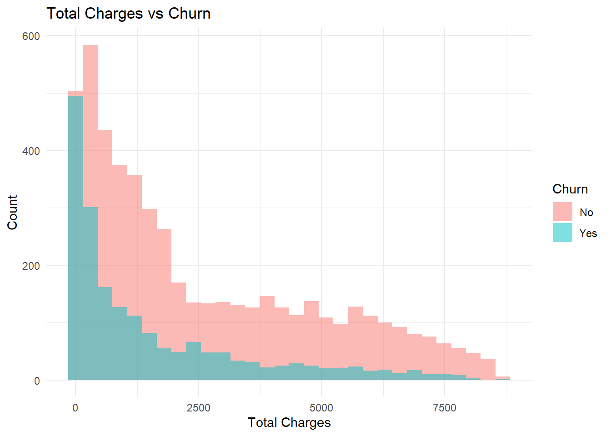{width=672}
:::
:::


A correlation analysis of Total Charges vs Churn is important because it helps the cmpany understand if there is a relationship between the total amount a customer has paid over time and their likelihood of leaving the service.

#### Feature Engineering

[Feature Engineering](https://www.tmwr.org/recipes) is one way we can create new input features in order to improve the performance of machine learning models, like finding or making predictions of which customer is most likely to churn


::: {.cell}

```{.r .cell-code}
# Create a new feature 'AverageCharges' as the ratio of 'TotalCharges' to 'tenure'
telco_data <- telco_data |> mutate(AverageCharges = TotalCharges / tenure)
# Check the distribution of 'AverageCharges'
ggplot(telco_data, aes(x = AverageCharges)) +
  geom_histogram(bins = 30, fill = "purple", color = "black") +
  labs(title = "Distribution of Average Charges", x = "Average Charges", y = "Count") +
  theme_minimal()
```

::: {.cell-output-display}
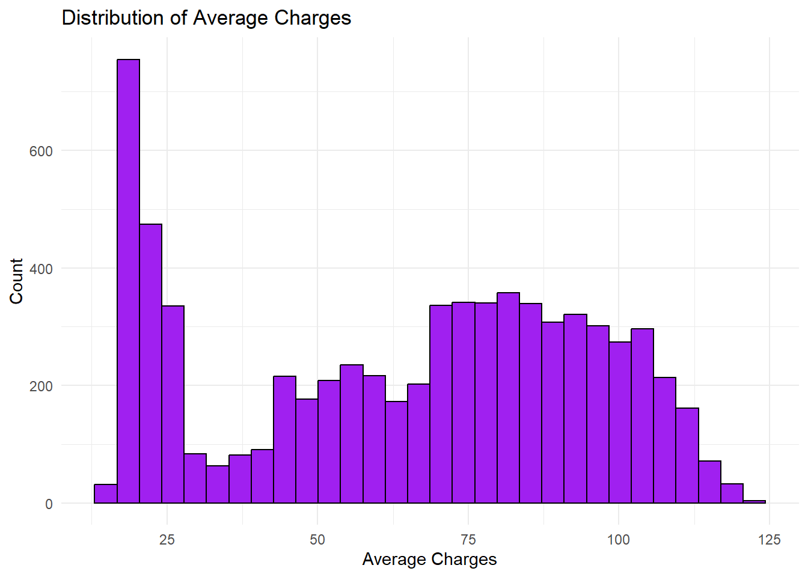{width=672}
:::
:::


However, designing predictive models based on this data set may require some skills since algorithms that assume normality (e.g., logistic regression, linear regression) may perform poorly on skewed data sets. We will need to perform some transformation. But we need not worry if we will be using the **tree-based models** such as random forest, but that is beyond the scope of the project
